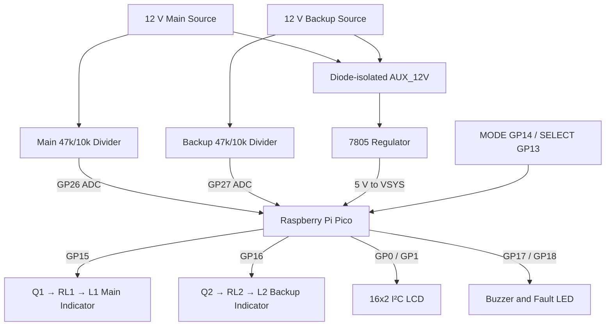
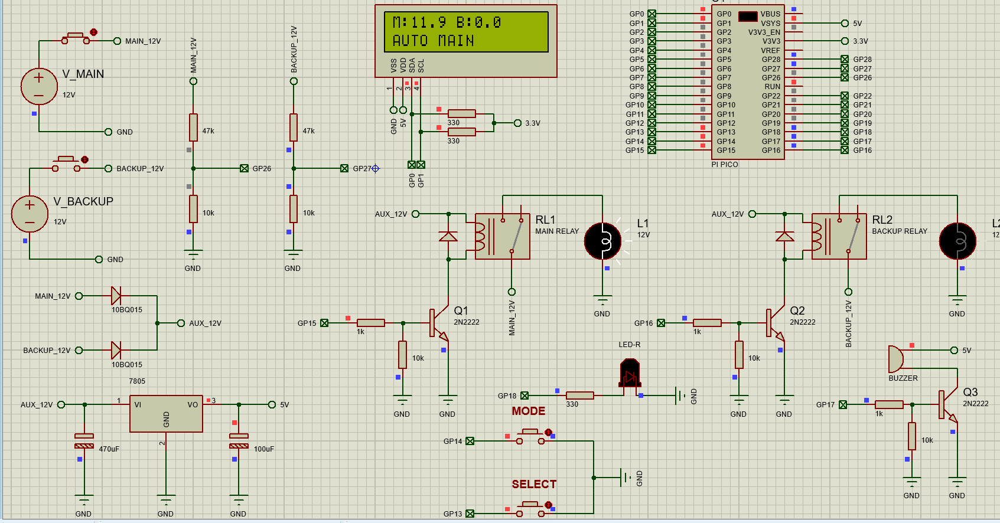
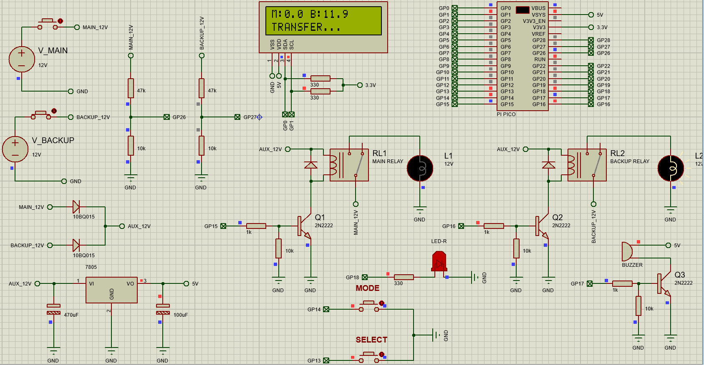
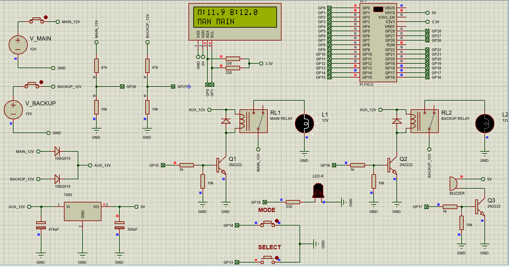
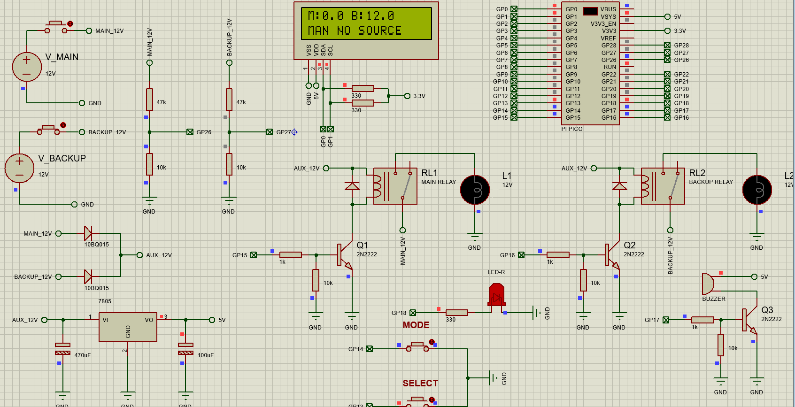

# Raspberry Pi Pico Smart Automatic Power Transfer System

**Proteus 8 simulation · Raspberry Pi Pico (MicroPython) · 12 V DC · Original V1 firmware**

> **Project status:** Basic simulated source-monitoring and relay-control states were observed and captured in screenshots. Precise transfer timings, oscilloscope waveforms, uninterrupted single-load transfer, fault tolerance, and physical hardware operation have **not** been verified.

## Overview

This project demonstrates a Raspberry Pi Pico monitoring two independent 12 V DC sources, prioritizing the main supply, and commanding a main or backup relay. It uses a 16×2 I²C LCD to display measured voltages and modes, push buttons for manual control, and buzzer/LED fault indicators.

**Important distinction:** In the supplied schematic and screenshots, **RL1 and RL2 drive two separate indicator lamps (L1 and L2)**. This demonstrates relay/source-selection logic; it does **not yet implement a physically transferred single shared load**. A true two-source automatic transfer switch would require suitable changeover contacts feeding one common load, verified interlocking, protective components, and electrical safety review. Do not describe the current hardware as a validated ATS.

## Short block diagram



*Diagram reflects the supplied two-indicator-lamp simulation; it is not an electrical wiring diagram for a power-rated ATS.*

## Components

- Raspberry Pi Pico (RP2040) and 16×2 I²C LCD (address `0x3F` in the supplied code)
- Two 12 V DC sources and manually operated source switches
- Two SPDT relay models, RL1 and RL2, driven by Q1/Q2 2N2222 transistors
- Two lamps, L1 and L2, as separate relay/output indicators
- 47 kΩ / 10 kΩ dividers feeding the Pico's ADC channels
- Diode-isolated `AUX_12V` supply, 7805 regulator and smoothing capacitors
- Flyback diodes, fault LED, buzzer driver, MODE and SELECT buttons

## GPIO mapping

| Pico pin | Connected to | Purpose |
|---|---|---|
| GP0 | LCD SDA | I²C data |
| GP1 | LCD SCL | I²C clock |
| GP13 | SELECT button | Manual source selection |
| GP14 | MODE button | Auto/manual selection |
| GP15 | Q1 / RL1 | Main output command |
| GP16 | Q2 / RL2 | Backup output command |
| GP17 | Q3 / buzzer | Warning output |
| GP18 | Red LED | Main-supply fault indication |
| GP26 / ADC0 | Main 47k/10k divider | Main voltage monitoring |
| GP27 / ADC1 | Backup 47k/10k divider | Backup voltage monitoring |
| VSYS | 7805 5 V regulator | Pico supply |

With a 47 kΩ top and 10 kΩ bottom resistor, a nominal 12 V source produces approximately **2.105 V** at the ADC input. The source voltage is reconstructed using a factor of **5.7**. These dividers provide voltage sensing, **not overcurrent protection**.

## Firmware — ORIGINAL VERSION USED

**`Firmware/main.py` is extracted byte-for-byte from `FIRMWARE/PI_PICO_1/main.py` embedded in the uploaded Proteus `.pdsprj` file.** It is the user's original V1 program, not the later experimental V2/V3/V4/V5 alternatives. `Firmware/main.txt` is an identical text copy.

Key configured values:

| Setting | Original V1 value |
|---|---|
| `LCD_ADDR` | `0x3F` |
| `SOURCE_ON_V` | `11.2` V |
| `SOURCE_OFF_V` | `10.4` V |
| `SENSOR_PERIOD_MS` | `60` ms |
| `FAILURE_MS` | `180` ms |
| `RECOVERY_MS` | `1500` ms |
| `DEAD_TIME_MS` | `250` ms |
| `SCREEN_PERIOD_MS` | `250` ms |

The original program prioritizes MAIN in AUTO mode, selects BACKUP only when MAIN is not qualified and BACKUP is, and commands both relays OFF during source switching. In MANUAL mode it permits only the specifically requested source to energize if that source is healthy.

## Simulation screenshots

The following screenshots were provided from Proteus simulation. They are **observations**, not independently calibrated oscilloscope measurements.

### 1. Automatic main-supply operation



Main measured at approximately 11.9 V; the LCD indicates `AUTO MAIN` while backup shows 0 V.

### 2. Supply-change/transfer screen



The main input shows 0 V, backup approximately 11.9 V, and the LCD displays `TRANSFER...`. This capture alone does not establish the elapsed transfer time or the final contact state.

### 3. Manual selection of main supply



Both supplies are indicated as available and the LCD reports `MAN MAIN`.

### 4. Manual selection with unavailable requested source



Main reads 0 V, backup about 12 V, and LCD reports `MAN NO SOURCE`. This is consistent with manual MAIN selection **not automatically falling back to BACKUP**.

## Can we capture electrical waveforms?

**Yes.** This is a DC switching system, so useful traces are **voltage steps and relay-command timing**, not sinusoidal waveforms or high-frequency PWM. No oscilloscope trace has been supplied or fabricated for this repository.

For a valuable oscilloscope screenshot, capture **GP26, GP27, GP15 and GP16 together** using Proteus DC-coupled channels. See [Oscilloscope capture guide](Documentation/OSCILLOSCOPE_CAPTURE_GUIDE.md) for exact probe locations and settings. After capturing a genuine trace, place the image in `Images/` and add a Markdown image link here.

## Running the project

1. Open `Proteus/Raspberry-Pi-Pico-Smart-Automatic-Power-Transfer-System.pdsprj` using a compatible Proteus 8 installation with the required Pico and component models.
2. The original MicroPython source is embedded in the supplied project. A separate identical copy is at `Firmware/main.py`.
3. Start with both 12 V sources connected and inspect `GP26`, `GP27`, `GP15`, `GP16` and the LCD.
4. Open the main-source switch to observe the control state transition; do not assume any exact transfer time from screenshots alone.
5. Press MODE to enter MANUAL and SELECT to choose the requested source; an unavailable manually selected source leaves the selection OFF rather than forcing backup.
6. Capture analog/digital traces, relay coil voltages, and actual lamp voltages to independently confirm behavior.

## Validation scope and limitations

**Observed from supplied captures:** the LCD reports plausible main/backup voltages and distinct automatic, transfer and manual states; at least one lamp is illuminated in relevant screenshots.

**Not verified:** captured GP15/GP16 timing; effective mechanical relay transfer interval; supply regulation under simultaneous loads; a common load actually transferring from one source to the other; overcurrent protection; power failure under realistic load; EMI; physical hardware testing.

The model's relay wiring and use of **two independent lamps** must be revised before claiming a complete single-load ATS. The 330 Ω pull-ups shown on SDA/SCL in the screenshots should be replaced with a sensible I²C pull-up value (e.g. 4.7 kΩ to 3.3 V) for hardware-ready design, and all protection/power ratings need review. Do not directly apply this circuit to 230 V AC.

## Repository structure

```text
Raspberry-Pi-Pico-Smart-Automatic-Power-Transfer-System/
├── README.md
├── LICENSE
├── .gitignore
├── Firmware/
│   ├── main.py               # EXACT V1 source embedded in the Proteus project
│   └── main.txt
├── Proteus/
│   └── Raspberry-Pi-Pico-Smart-Automatic-Power-Transfer-System.pdsprj
├── Images/
│   ├── 01_auto_main_backup_unavailable.png
│   ├── 02_supply_change_transfer_display.png
│   ├── 03_manual_main_selected.png
│   └── 04_manual_main_unavailable.png
└── Documentation/
    ├── OSCILLOSCOPE_CAPTURE_GUIDE.md
    ├── PROJECT_NOTES.md
    └── GITHUB_SETUP.md
```

## Author

**L.N. Sehlabane** — Electrical Engineering / Embedded Systems

## License

MIT License for author-created materials supplied here. Proteus, third-party component models and development libraries retain their respective rights and licenses.
